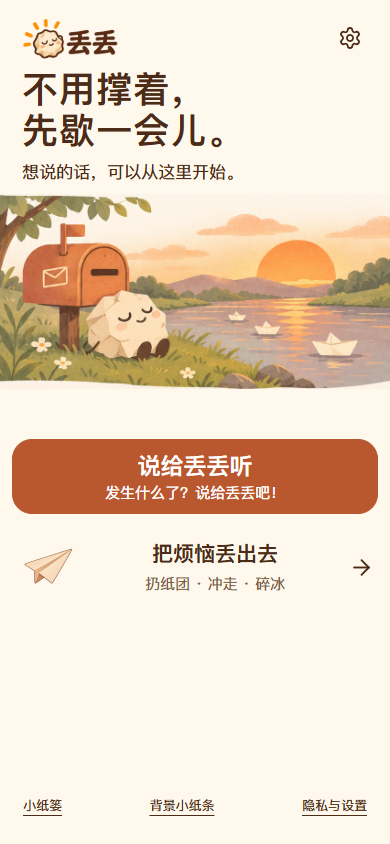
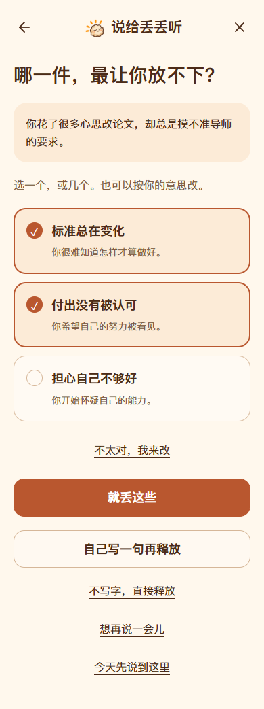
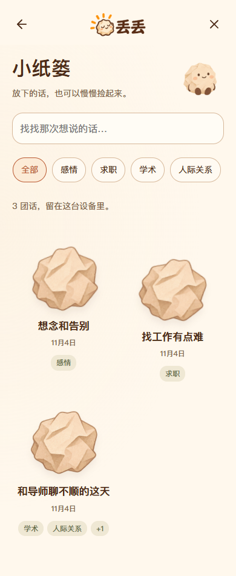

# 丢丢产品项目案例

产品经理作品集与 STAR 面试复盘

整理日期 2026 年 11 月 4 日

## 项目概览

丢丢是一款以纸团 IP 为陪伴载体的移动端 Web 产品，围绕日常烦恼，连接表达、回应、重点确认、互动释放与自愿保存。核心产品判断是：人在倾诉时，可能需要被理解、一起想办法，或先完整说完；产品需要先尊重这三种需求，再决定怎样回应。

目前已完成可运行的移动端 Web、三种释放玩法、真实文字回应、图片理解、录音转写、公开网络参考以及本机“小纸篓”，并发布到 CloudBase 预览。31 项自动化单元检查和真实服务联调已有记录。当前证明的是功能可运行与关键规则得到验证；尚无足够真实用户研究、留存、付费或情绪改善数据。

本案例面向产品经理作品集与面试，重点解释需求判断、流程取舍、迭代依据、执行协作和结果证据。这里的“用户”指产品服务对象；应用内的回应称呼统一使用“你”。

### 基本信息

- 产品形态：移动端 Web，可通过链接打开；本地释放功能不依赖模型密钥。
- 阶段：个人产品原型已经推进到可运行、接入真实服务的 MVP，适合开展首轮真实用户可用性验证。
- 产品主张：说给丢丢听，把烦恼丢出去；回应方向、结束时间、释放重点和保存意愿由使用者决定。
- 技术实现：静态 HTML、CSS、JavaScript 模块，CloudBase 登录与事件云函数，火山方舟模型，豆包公开搜索，IndexedDB 本地记录。
- 交付物：产品策划、原始 UI 与 IP 素材、可交互前端、云函数、说明文档、自动化检查与实际联调证据。
- 体验地址：[丢丢预览](https://diudiu-d4gfzywne315e65b5-1524741572.tcloudbaseapp.com/diudiu-ai-preview/)。在线服务需要应用账号，作品集不公开账号密码。
- 项目仓库：[zxy0616/diudiu](https://github.com/zxy0616/diudiu)。本文功能基线为提交 `9cd5d73`。

### 个人职责与协作方式

依据本次协作记录，项目发起者提出产品方向、关键文案、交互纠偏、保存策略和服务配置选择，并持续验收、推动迭代；设计拆解、文档、代码和联调通过 AI 工具辅助完成。适合在面试中表述为“主导产品定义与迭代，借助 AI 推进设计、实现和验证”。

现有资料不足以证明独立完成全部编码、管理过真实研发团队、拥有正式用户研究样本或产生商业收入。本文不补造团队人数、工作时长、增长指标和独立开发经历；正式投递前，应按个人实际工作核对职责措辞。

## 一 项目背景与问题定义

### 日常倾诉的需求存在差异

一个人说“为什么找不到工作”，可能是在寻找现实办法；说“导师好苛刻”，可能先需要情绪被接住；持续讲述时，则可能不希望立即收到解释、追问或建议。同一段文字里的疑问和情绪也可能并存，不能只靠一个关键词强行判断。

丢丢将这一区别转化为显式的回应选择。自动分析只提供辅助理解，明确选择优先。这是产品设计假设，来自需求讨论和体验反馈；目前没有独立访谈、问卷或大样本数据证明其普遍性。

### 要解决的具体问题

1. 开口负担：烦恼不一定容易组织成完整文字，聊天截图、照片和语音常常包含重要上下文。
2. 回应错位：想要共鸣时收到行动清单，可能增加被评价的感受；想找办法时只有泛泛安慰，也难以推进。
3. 倾诉被打断：还没有说完就收到总结、建议或登录要求，会切断表达节奏。
4. 表达与释放脱节：如果释放道具没有对应的烦恼重点，互动容易成为与本次倾诉无关的小游戏。
5. 再次表达成本：完全临时的会话不方便继续，但默认长期保存又可能违背隐私预期。

### 目标人群与使用场景

优先关注有日常学习、求职、工作、人际或感情烦恼，希望获得低压力表达空间的人。以下场景是待验证的任务假设，不能作为已完成的用户画像研究。

- 求职场景：投递后迟迟没有回复，希望先被理解，或一起梳理下一步能尝试的行动。
- 学术场景：论文反复修改、导师要求变化，想完整说出疲惫，再确认最在意的事情。
- 人际场景：一张聊天截图难以用几句话解释，希望在遮挡身份信息后提供上下文。
- 即时释放场景：暂时不想讲述，只想通过投纸团、冲走便签或砸冰块缓一缓。
- 续聊场景：上次的话还没有说完，希望主动保存后，在同一浏览器继续。

### 产品定位与替代方案

丢丢定位于非紧急日常烦恼的表达、陪伴与轻量互动。它不提供心理诊断、治疗或专业咨询，不保证情绪改善，也不能替代现实中的支持与紧急帮助。

从使用者已有的替代行为看，熟人倾诉能提供现实关系支持，私人日记能保留表达，通用聊天工具能回应问题，独立小游戏能提供互动。丢丢尝试把“选择怎样被回应”和“将本次烦恼带入释放”组合起来。以上是产品定位分析，未开展竞品实测，不将其写成已证实的市场优势。

## 二 产品目标与范围

### 本阶段目标

本阶段先把关键体验做成真实可运行的流程，再验证使用者是否理解、是否愿意继续使用。目标依次是：统一表达入口、尊重回应方向、保障完整倾诉、让烦恼重点可确认、建立表达与释放的连接，并把保存权交给使用者。

这些目标对应可检查的行为：共鸣分支不默认给解决清单；静默分支不提前调用识别、回应或搜索；整理只能由主动结束触发；重点可以多选、修改、否定或留白；纸人只有在主动结束时倒下；记录只在主动保存后进入本机小纸篓。

### 已纳入 MVP 的能力

- 入口与账号：前置登录提示；已有登录状态免重复提示；首页只保留倾诉、释放及管理入口。
- 表达：文字、最多三张图片、最长 120 秒录音；图片检查、裁剪、实心遮挡；录音试听和取消。
- 陪伴：共鸣、解决、先说完三种方向；温和的第二人称表达；方向可切换。
- 理解：同意后识别图片与录音，识别结果可修正；结束后生成多个候选重点、主题与标签。
- 参考：按关键词分别检索三个社交平台的公开网页，展示实际来源、平台筛选和空结果。
- 释放：纸人靶子、冲水、砸冰块；使用已确认的烦恼重点，支持直接手写或空白释放。
- 保存：小纸篓主动保存、自动与自定义标签、搜索、继续说、碎纸删除；本机背景小纸条单独管理。

### 暂不纳入的能力

云端会话同步、跨设备续聊、站内全量社媒搜索、视频字幕抓取、设备运动监听、自动危机识别、付费订阅、消息推送与运营增长系统均未实现。原始 IP 动作是关键姿态，前端的轻量动效不等于完整连续动画资产。

### 优先级判断

第一优先级是表达能顺利完成、方向不被覆盖、内容不被错误理解、个人信息不被默认保存。第二优先级是建议参考、识别便利性和复用历史。视觉细化、真机体验与真实用户验证则是下一阶段的重要工作。

这解释了几个取舍：先采用可直接打开的 Web；保留本地释放入口；把网络能力放在登录与同意之后；不为补齐来源而伪造平台内容；小纸篓采用本机保存，接受无法跨设备的限制。

## 三 功能架构与完整体验

### 首页与导航

首页使用原 Logo、河岸插画和纸团 IP，主入口为“说给丢丢听”，小字为“发生什么了？说给丢丢吧！”。另一个入口为“把烦恼丢出去”。首页不再提供输入框，避免先在首页写一次、进入倾诉页后又面对同样的输入动作。

首次打开会提示登录；已有有效登录状态直接进入。取消登录后可以浏览和体验本地释放，但进入新的在线倾诉或从小纸篓继续说时，会先检查登录。正常倾诉中不再自动弹出登录框；会话意外过期时保留内容，由使用者主动恢复。

### 倾诉主流程

登录就绪 → 点击说给丢丢听 → 统一输入文字、图片或录音 → 首次发送后选择方向 → 在联网同意范围内回应或安静倾听 → 点击“就说到这儿吧” → 整理烦恼并选择重点 → 可选释放 → 决定是否保存。

输入前提供图片隐私检查，录音由主动操作开启。第一次使用在线理解时说明会处理哪些文字、图片和录音，并提供寻找相似经历的开关。关闭相似经历搜索不等于关闭模型回应。

### 三种回应方向

“想要共鸣”优先回应具体处境和感受，避免自动给行动清单；网络中的相似经历仅供陪伴参考，不把个体经历当作所有人的规律。

“想要解决”先承接处境，再提供少量可选、现实的小建议，保留适用条件和选择权。不用“你必须”“你应该”等说教表达，也不保证某个办法有效。

“不知道，先说完！”允许连续发送。页面为纯色背景和小 IP 倾听点头，暂不输出回应文字，也不提前识别附件、分析或检索。只有主动结束后，才在同意范围内识别、整理。

### 从整理到释放

结束后显示“丢丢正在整理你的烦恼”。结果包含自然概括及多个候选重点，信息充足时通常提供二至五项。可以选一个或多个，也可以纠正、自写一句或不写字直接释放。

这里使用“候选重点”，而不把结果称为确定的“烦恼根源”。模型可能误解关系和动机，确认环节用于把最终解释权交回使用者。整理只读取倾诉原话与识别内容，不将丢丢此前给出的建议当成本人经历，也不将检索到的他人经历混入事实。

纸人和冰块承载已确认的短句，多个重点可以随动作轮换展示。纸人支持持续重复投掷纸团，只有主动结束发泄才倒下；冲水可以选择卡通马桶或水流漩涡，只冲走本轮便签；冰块支持完整、裂纹、碎裂与重来，当前使用点击交互。

### 结束与本机小纸篓

结束后可以选择继续说、换一种释放方式、回到首页或把这次的话留下。不要求情绪一定变好，也不将“好一点”作为通关条件。

保存时可以修改标题、移除自动标签、添加自定义标签，并选择是否保留原图片与录音。文字与识别结果随主动保存的记录保留；原媒体默认不保存。小纸篓以多个小纸团呈现，支持按内容、主题、标签查找，打开后可以继续说或确认碎纸删除。

当前保存只属于同一站点、设备和浏览器，不随登录账号跨设备同步。清除浏览器数据可能丢失记录。删除本机内容也不等于删除模型或搜索供应商可能保留的处理记录。

## 四 UI 与 IP 的设计判断

视觉沿用已有温暖、治愈、卡通的纸团风格。河岸和落日承担进入前的情绪氛围，纸团 IP 承担陪伴反馈；对话页则减少场景干扰，让表达和当前状态成为重点。

原始设计包包含 29 个页面与状态 PNG、三张总览、四份 Logo、八种 IP 情绪、八个动作、八个道具、河岸场景及规范，共 76 个文件。素材已核验并保留。29 指原稿状态数量，不能等同于当前线上独立页面数量。

### 关键体验取舍

- 入口集中：移除首页输入框，减少重复动作；登录也前置到表达开始前。
- 反馈克制：静默期间使用小 IP 点头，不用追问和文字安慰反复占据注意力。
- 文案自然：对话称呼“你”，隐藏模型、检索词、处理路径等工程信息；隐私页移除原设计目录和策划案入口。
- 信息可纠正：识别内容可折叠查看并修改；烦恼重点可多选，避免“一句话替你下结论”。
- 保存具象：纸团与小纸篓沿用同一隐喻；保留与碎纸是明确操作，不默默归档。
- 实现诚实：复用独立素材与设计变量，不将整页图片伪装成交互，不宣称像素级还原。

### 主要界面证据

以下为当前实现的截图，示例记录和识别内容均为虚构或合成测试材料。

首页双入口，点击后再输入。

候选重点由使用者选择，可选择一个或多个。

本机小纸篓按纸团呈现记录，支持主题与标签查找。

## 五 AI 能力与信任设计

### 理解与回应的组织方式

文字、图片识别结果与录音转写作为不同来源进入上下文。后台分析当前需要、主题标签和具体关键词；明确的共鸣或解决选择优先于自动判断。关键任务是保持回应匹配，而不是向使用者展示整套处理步骤。

图片处理尽量保留聊天双方的区分及客观画面，不推测身份、心理疾病和他人动机；识别不清时保留不确定性。录音先转成文字，再参与同一套回应、整理与标签流程。识别结果可以改，原媒体不会为每次回复重复上传。

当前音频通过独立 AUDIO_MODEL 接入用户选择的 Doubao Seed 2.0 mini 模型。浏览器将录音转为单声道 WAV 并分段，降低不同录音编码造成的问题。实现已通过有效合成英文语音与线上混合媒体流程验证；中文真人语音和各类手机兼容性尚未完成验证。

### 共鸣与建议的边界

生成约束要求承接具体事情、温和积极、少套话、不诊断、不保证结果。共鸣不默认解决问题，建议也保留选择余地。不声称是真人，不承诺永远陪伴。提示词约束只能降低风险，不能据此宣称所有回答都已经达标；后续需要独立样例评审与真实体验验证。

### 社交平台参考的处理

搜索服务是豆包搜索对公开网页的检索，不是小红书、微博或抖音 App 的站内全量搜索。登录后可见内容、评论、未收录笔记和视频字幕都不保证覆盖。

初版将三个平台合在一起取排序靠前的少量结果，容易被微博占满。迭代后分别限定平台域名，每个平台最多尝试两组关键词，再按平台交错合并，最多保留六条来源。不能用一个平台的内容填补另一个平台，也不能因为页面需要卡片就编造资料。

一次虚构学术场景联调共进行了五次搜索，微博返回五条可用来源，小红书和抖音均为空。该结果证明这次查询的实际返回情况，不证明两个平台永远没有内容，也不能证明实现了三平台完整覆盖。来源页因此提供平台筛选和真实的未找到提示。

### 隐私与失败处理

在线理解需要登录和发送同意；密钥保存在云函数环境变量。媒体通过受保护的请求发送，不生成公开文件链接。小纸篓只在明确保存后写入浏览器，原附件另行选择。

无法识别、模型不可用、搜索失败或没有结果时，保留已有表达，可以重试、改用文字或手写重点，不退回冒充真实结果的预设话术。切换方向、停止等待或退出后，旧请求的结果不得插入新会话。停止等待也不能保证撤销已经发生的服务调用。

## 六 项目落地与关键取舍

### 从交互验证开始

最初先完成不需要密钥的交互体验版，用清楚标记的演示内容验证流程。这样可以先对照原 UI 验收倾诉、方向选择、重点确认和三种释放，再引入网络、账号与模型依赖。真实服务接入后，正式流程不再使用预设回应兜底。

### 在既有资源约束下接入真实服务

CloudBase 体验版对内置文字模型的启用有限制，因此沿用体验版，通过事件云函数直连已有火山方舟接口。没有为完成演示而自动升级套餐或开启额外购买。搜索与识别也由服务端调用，前端不持有供应商密钥。

### 本机保存优先

使用者明确选择小纸篓仅保存在本机浏览器。因此采用 IndexedDB 保存文字、识别结果、标签及可选媒体，避免引入尚未需要的云端历史同步。代价是设备迁移不便、浏览器清理可能丢失数据，界面需要提前说明。

### 对能力误判进行纠正

音频联调曾返回 InvalidParameter。进一步检查发现，早期合成样本是没有语音数据的空 WAV，不能据此认定模型不支持音频。改用有效样本后，已配置的 AUDIO_MODEL 成功转写，并增加了空录音前置校验。

这一过程体现的不是“首次接入完全正确”，而是依据证据定位问题、纠正判断，再把问题转化为可重复的检查。面试讲述中应保留这一复盘，避免把联调错误包装成模型能力结论。

## 七 版本演进与需求闭环

下列按产品能力阶段组织。只有原设计 v1.0、v1.1 和文档中的 v1.3 增量沿用已有标记，其余是阶段名称，不补造正式版本号。设计阶段缺少精确日期；Git 记录中的实现提交集中在 2026 年 11 月 4 日，不能据此认定整个项目从构思到交付只用了一天。

### 设计 v1.0 形成视觉与流程基础

围绕温暖卡通风格确定纸团 IP、首页双入口与倾听释放结构，形成最初的 UI、Logo、情绪与动作素材。可见会话记录描述初期为 21 个页面与状态；对应阶段为静态设计，尚不是可运行 Web。

### 设计 v1.1 从倾听升级为三方向选择

需求反馈强调语音、文字、图片组合输入，以及“想要共鸣”“想要解决”“不知道，先说完！”三种方向。静默分支不提前给回应；结束后再整理。烦恼重点进入释放道具，重点需确认和可编辑。原包扩展为 29 个状态。

### 交互 MVP 将设计变成可运行产品

接收并核验完整原包，保留 76 个原始文件，完成移动端 Web 与产品策划。补齐文档中遗漏的冲水方式；纸人改为持续可击打、主动结束才倒下。覆盖图片本地编辑、录音、隐私与异常分支。

证据：`ad0fec5` 与 `621fee8`，分别对应 Web 与策划交付、原素材字节保留和可移植静态构建。代码提交时间为 2026 年 11 月 4 日 00 时段。

### 在线 AI 阶段 接入登录保护与真实生成

在既有 CloudBase 环境中接入普通应用账号、受保护的云函数和已有模型接口。回应与提炼开始使用真实模型，并验证真实登录与服务往返。服务失败不能冒充生成成功。

证据：`03a2a00`，2026 年 11 月 4 日 18 时段。受套餐限制的内置模型未启用，采用云函数调用已有外部接口。

### 公开检索阶段 增加可追溯参考

在主动同意的前提下检索公开内容，增加真实来源卡片、搜索开关和失败分支。此时早期实现仍有可见检索词审核等工程性文案，后来根据体验反馈移到后台。

证据：`9acca53`，2026 年 11 月 4 日 19 时段。

### v1.3 增量 改善表达并加入小纸篓

针对“AI 味”、单一总结和不能续聊的问题，调整第二人称、温和口吻和处理信息的呈现；“想要解决”去掉括号内容；静默页面移除河岸大图，只留小 IP 动效；结束按钮移到底部并改为“就说到这儿吧”。

同时增加多选烦恼重点、小纸篓、自动与自定义标签、搜索、继续说和碎纸删除。记录按使用者选择仅保存在本机。已通过真实保存、刷新和继续倾诉的流程验证。

证据：`813d1e5`，2026 年 11 月 4 日 20 时段。

### 登录位置修复 将前置条件放在表达前

反馈指出，倾诉后才要求登录会造成体验断点。登录提示前置，首页、新倾诉、背景小纸条和小纸篓续聊入口共同检查；意外过期保留内容并允许主动恢复。

证据：`e0d7c46`，2026 年 11 月 4 日 21 时段。

### 媒体与分平台增量 让输入真正被理解

移除首页输入框，把输入统一到倾诉页；图片理解和录音转写接入真实服务，识别结果可核对、可修改、可保存。静默分支继续等主动结束后再处理附件。

针对只有微博来源的反馈，将三个平台分别搜索并交错合并，补充平台筛选与真实空结果说明。语音联调修正空 WAV 样本问题后完成验证。

证据：`9cd5d73`，2026 年 11 月 4 日 21 时段；本文功能快照截至该提交。

## 八 已取得的结果及证据边界

### 已交付的产品结果

已经从静态设计推进到可运行的移动端 MVP，覆盖三向陪伴、三种释放、多选重点、本机续聊和真实多模态服务。产品可以展示完整任务，不只是若干界面截图。

可以量化的交付事实包括：原包 76 个文件完成核验；保留 29 个原始设计状态；实现三种释放玩法和三种回应方向；当前记录有 31 项单元检查通过。纸人连续 12 次投掷仍保持站立、主动结束才倒下的行为已有浏览器检查记录。

### 已验证的服务与交互

真实应用账号登录、刷新后保留登录、文字回应与烦恼提炼、公开来源检索、图片识别、有效合成语音转写、线上混合媒体输入到真实回应再到多选重点的流程均已有联调记录。

本地归档检查覆盖主动保存、标签、自定义标签、刷新、搜索、继续更新、定向删除、媒体保留和额度不足时保留旧记录。响应布局检查覆盖 320、360、390、430、1280 等宽度场景；这是桌面 Chrome 模拟检查，不等于真机认证。

### 尚不能声称的结果

没有正式用户访谈、足够的用户测试样本、日活、留存、付费、转化率、实际成本下降或情绪改善数据。不能写“满意度提升百分之多少”“缓解焦虑”“提升留存”或“实现全平台社媒覆盖”。31 项检查衡量的是规则与功能，不是用户价值或临床成效。

### 当前主要限制

真实设备 Safari 与 Android、中文真人录音、弱网与长时使用、多标签页行为等仍需要补充测试。模型可能识别错误或理解偏差，提示词不能取代质量评估。社媒搜索受公开网页收录限制；本机归档不能跨设备。产品没有自动危机识别、运动监听和正式运营数据。

## 九 用户验证与指标规划

### 首轮研究建议

下一步建议邀请六至八名自愿体验者，以虚构或自选的非敏感场景完成任务。该人数是研究计划，不是已招募或已完成样本。优先观察：能否理解三方向、是否感到被打断、能否纠正识别与重点、是否知道保存位置，以及是否能顺利结束。

任务可包括：只想被理解、先连续说完、想找可选办法、仅发送图片或录音、直接释放、保存后刷新并继续。记录操作路径和理解偏差，允许随时退出；不要求暴露真实隐私，也不要求情绪一定好转。

### 核心指标口径

- 回应方向理解：能正确描述各方向差异的人数与参与人数，同时保留具体误解，不只看一个比率。
- 倾诉任务完成率：完成对应任务的人数除以尝试该任务的人数；需要区分自主结束和因故障退出。
- 重点确认情况：直接选择、修改后选择、自写或留白的分布。修改多不必然代表失败，也可能体现自主表达。
- 静默打断情况：任务中是否出现非主动触发的文字回应、识别或搜索；规则层面应为零，主观感受另行询问。
- 媒体可用性：成功识别次数除以有效识别请求数；另记录修正比例与可理解性。有效样本需排除空录音等输入问题。
- 续聊可用性：主动保存后能够在同一浏览器找到并继续的任务完成情况。
- 服务质量：有效成功率、响应时延、失败类型、实际调用量及单次任务成本。当前尚无完整基线，不能填入效果数字。

这些是建议口径，尚未部署业务埋点。若引入统计，应明确告知，只采集必要事件，避免上传倾诉正文、转写、截图、原始搜索词和身份信息。

### 上线前后的优先事项

优先处理真实设备与中文语音验证、内容质量与纠错、登录过期和弱网恢复、保存与删除的可理解性。完成小样本任务测试后，再决定是否需要调整三个方向、保存入口和释放玩法。

当使用价值有初步证据后，再考虑更可靠的参考内容源、跨设备保存的自愿方案和持续成本控制。跨设备能力需要单独处理授权、保留与删除，不应直接将本机记录默认上传。

### 运营和商业化的阶段判断

当前仍应以验证需求和体验为主，没有收费或收入结果。后续可研究自愿购买的视觉主题或 IP 周边等方向，但这些只是备选假设。基础表达、正常退出和必要支持不应被人为设计成付费障碍，也不应以延长负面情绪停留作为运营目标。

## 十 STAR 完整项目复盘

以下按项目发起者和产品负责人的视角整理。适合面试讲述，职责与证据需要和本人实际经历一致。

### S 情境与背景

“我想做一个面向日常烦恼的低压力表达产品。最初已经有温暖卡通的纸团 IP 与静态 UI，但还缺少可运行的完整体验。梳理流程时，我发现同样是倾诉，有人需要共鸣、有人需要建议，也有人只想先完整说完；如果直接自动回复，就容易回应错位。后续实际体验还暴露了登录中断、首页重复输入和媒体只被保存却没有被理解的问题。”

背景约束包括：现有设计与素材需要保留；先从移动端 Web 验证；CloudBase 保持体验版；服务密钥只能保留在云端；会话归档采用本机保存；没有现成用户研究与增长数据。

### T 任务与目标

“我的任务是把静态设计推进成一个可以完整体验、接入真实服务的 MVP，并建立清楚的验收规则。最重要的不是多加几页，而是让使用者决定怎样被回应、何时结束、丢掉哪些烦恼，以及要不要保存。我负责需求和优先级判断、关键流程及文案、方案取舍与验收方向，通过 AI 协作推进设计、开发和联调。”

本阶段成功标准是核心任务可完成、静默不被自动打断、重点可纠正、三种释放符合规则、保存与删除可理解，以及网络能力没有被虚构。尚不把留存或商业收入作为已达成目标。

### A 行动与关键决策

“我先把倾诉拆成共鸣、解决和先说完三条路径，让明确选择优先于自动判断。静默模式只留小 IP 倾听，主动说完后再整理。之后把整理结果改成多个可选重点，保留编辑和留白，再带到纸人、冲水和冰块中，连接表达和释放。”

“在迭代中，我将登录前置，移除首页重复输入，把温和文案和必要反馈留给界面，把检索词及处理步骤放到后台。针对续聊需求，我选择主动保存到本机的小纸篓，加入自动标签、自定义标签、搜索和碎纸，接受暂时无法跨设备的限制。”

“真实服务先接入受保护的文字回应和公开搜索，再让图片与语音识别结果参与回应和提炼。对只有微博来源的问题，我推动分别搜索三个平台并保留真实空结果。AI 辅助联调排查到空 WAV 样本后，修正了错误归因，并补上前置校验。”

### R 结果与复盘

“截至当前，产品已形成可运行的移动端 Web，覆盖三种回应、三种释放、多选重点、本机记录和真实多模态理解。项目保留了 76 个原始素材文件，当前有 31 项单元检查通过，并完成真实登录、识别、回应、提炼以及保存续聊的联调。需要强调，这些是交付和功能验证结果，不是用户留存或情绪改善结果。”

“最大的收获是把自主权落实为具体规则：何时回应、何时识别、选择哪些重点、是否保存，都由使用者触发。同时我也学到，联调错误、接口能力和样本质量需要分开判断，不能看到报错就贸然归因。下一步应先做真实用户任务测试和真机验证，再讨论增长和商业化。”

## 十一 面试可展开的三个决策案例

### 案例一 用三方向替代默认自动回应

S：日常倾诉的需求不同，自动回复可能打断或说教。T：在有限界面中让回应匹配当前需要。A：设置三个显式方向，允许切换；共鸣与建议使用不同约束；静默只留 IP 反馈，等主动结束再处理。R：三条分支已经运行，静默连续输入、零提前调用和主动结束已有检查；主观的被理解感仍需用户验证。

适合展示：问题拆解、需求优先级、状态设计、验收规则。不能替换成“满意度显著提高”。

### 案例二 用自愿保存连接一次表达和再次回来

S：临时会话不方便继续，默认长期保存又可能不符合预期。T：兼顾续聊和内容控制。A：采用本机小纸篓，主动保存，标签和原附件可选；提供继续说、搜索和确认碎纸；保留独立的背景小纸条。R：刷新后找回、续聊更新、定向删除及额度失败回滚已有验证；跨设备能力与真实复访数据尚不存在。

适合展示：体验连续性、数据边界、方案取舍、异常设计。不能替换成“提升次日留存”。

### 案例三 区分搜索策略问题和内容覆盖限制

S：相似经历只有微博来源，无法判断是排序还是平台覆盖问题。T：给出可解释、可追溯的参考。A：分别检索三个平台、核验实际域名、交错合并，并提供平台筛选和空结果。R：实测这次仍为微博五条、另外两平台为空，从而明确当前接口边界，避免伪造多平台覆盖。

适合展示：假设验证、依赖管理、结果诚实、信任设计。不能替换成“已经打通三平台全部内容”。

## 十二 简历与面试表达

### 简历描述草稿

丢丢 移动端情绪表达产品 产品定义与迭代负责人

- 主导将纸团 IP 静态设计推进为移动端 Web MVP，定义共鸣、解决、静默倾听三条路径，并连接多选烦恼重点与纸人、冲水、碎冰三种释放体验。
- 根据体验反馈前置登录、统一倾诉入口，设计本机小纸篓、自动与自定义标签、续聊与删除；借助 AI 完成真实文字、图片、录音理解及公开来源检索的接入。
- 建立关键行为验收与能力边界，当前有 31 项单元检查及真实服务联调记录；原始 76 个素材文件完成核验，未将功能测试等同于用户增长或情绪改善。

以上是依据现有记录形成的草稿，不应加入没有证据的用户数、收入、效率提升比例或团队规模。

### 两分钟项目介绍

“丢丢是我主导定义和迭代的一个移动端 Web 项目，服务于日常烦恼的表达和轻量释放。最初有温暖纸团 IP 和静态 UI，我希望把它推进成一个能完整体验的产品。我最关注的是回应自主权，因为倾诉不一定等于要建议。”

“所以我把流程拆成共鸣、解决和先说完，明确选择优先。先说完时只用 IP 倾听，等主动结束才识别附件和整理。整理结果不是直接判断根源，而是给几个候选重点，让使用者多选、修改或留白，再进入纸人、冲水或冰块互动。”

“迭代中，我根据体验问题前置登录、移除首页重复输入，并加入主动保存的小纸篓。通过 AI 协作完成了真实文字、图片和录音理解，以及公开网络参考接入。对社媒只有微博结果的问题，我们分别检索并保留真实空结果，明确接口的覆盖限制。”

“目前交付是一个可运行、已发布的 MVP，有 31 项单元检查和真实流程验证。还没有留存或情绪改善的数据。下一步会做小样本任务测试和手机验证，重点看三方向是否容易理解、是否觉得被打断、重点是否贴合，以及保存续聊能否顺利完成。”

### 常见追问的回答方向

你真正做了什么：讲清自己提出的需求、否定过的方案、取舍和验收，不把 AI 生成代码说成独立手写开发，也不虚构团队管理。

为什么保留三种方向：它们分别承接被理解、寻找行动和完整表达的差异；同时承认三分法是待验证的设计，不是已经得到统计证明的人群划分。

为什么先问登录：把在线服务的前置条件放在表达之前，降低中断；意外过期则保留内容，不自动弹窗打断。

如何证明项目有效：先展示任务可完成和规则正确的证据，再说明用户价值证据仍缺失，以及准备怎样补充。不要用技术通过率替代业务成效。

为什么不做云端历史：这是明确的保存选择。本机方案减少同步复杂度，代价是设备迁移与数据丢失风险，需要让使用者理解。

如何处理 AI 说错：从输入识别、事实归属、回应方向、候选重点和来源五层提供约束与纠错；保留失败状态，不承诺模型完全可靠。

如果继续投入先做什么：先补用户研究、真机及中文真人录音验证、内容质量评审、弱网和恢复体验，再按证据决定来源扩展与跨设备能力。

## 十三 证据与引用

### 资料依据

1. 本次连续协作中已确认的需求、纠正与配置选择，包括三种释放、三方向、温和口吻、小纸篓本机保存、登录前置、首页统一输入和媒体识别。
2. 用户提供的 UIUX 与 IP 素材包 v1.1，保存在仓库 design-kit；76 个原始文件的校验记录见素材核验文档。
3. [产品策划案](../产品策划案.md)、[验证说明](../验证说明.md)、[自然对话与小纸篓](../小纸篓与对话说明.md)、[媒体识别与分平台搜索](../媒体识别与分平台搜索.md)及代码实现。
4. Git 提交记录与实际联调结果。本文没有重新假定测试结论是用户研究，也没有重新调用涉及私人倾诉的生产数据。

关联旧会话《修改丢丢PRD》的全文在本轮无法直接取回；早期设计阶段依据本会话已有的可见会话摘录、用户明确描述与原包核验。无法确认的日期、人数、职责与商业成效不补写。

### 提交索引

- [ad0fec5 首个 Web 与策划](https://github.com/zxy0616/diudiu/commit/ad0fec5)
- [621fee8 素材保留与静态构建](https://github.com/zxy0616/diudiu/commit/621fee8)
- [03a2a00 真实文字 AI](https://github.com/zxy0616/diudiu/commit/03a2a00)
- [9acca53 公开检索](https://github.com/zxy0616/diudiu/commit/9acca53)
- [813d1e5 自然对话与小纸篓](https://github.com/zxy0616/diudiu/commit/813d1e5)
- [e0d7c46 登录前置](https://github.com/zxy0616/diudiu/commit/e0d7c46)
- [9cd5d73 媒体识别与分平台搜索](https://github.com/zxy0616/diudiu/commit/9cd5d73)

### 使用这份作品集时的事实边界

已经实现和验证的内容可以直接讲述；设计动机、目标人群和下一阶段指标应作为判断或假设表述。原始设计状态、线上流程、测试样本和真实用户数据应分别说明。涉及个人能力的简历句子，应以本人能够解释、展示和承担的实际工作为准。
